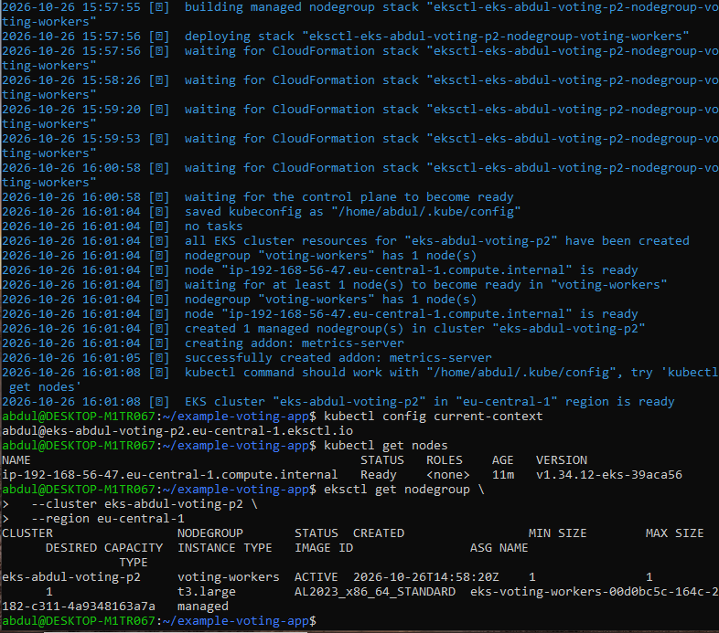
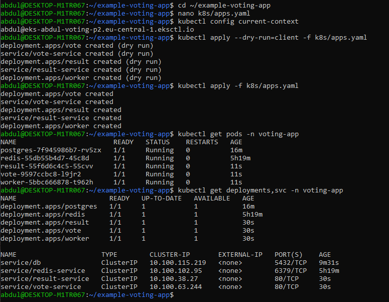
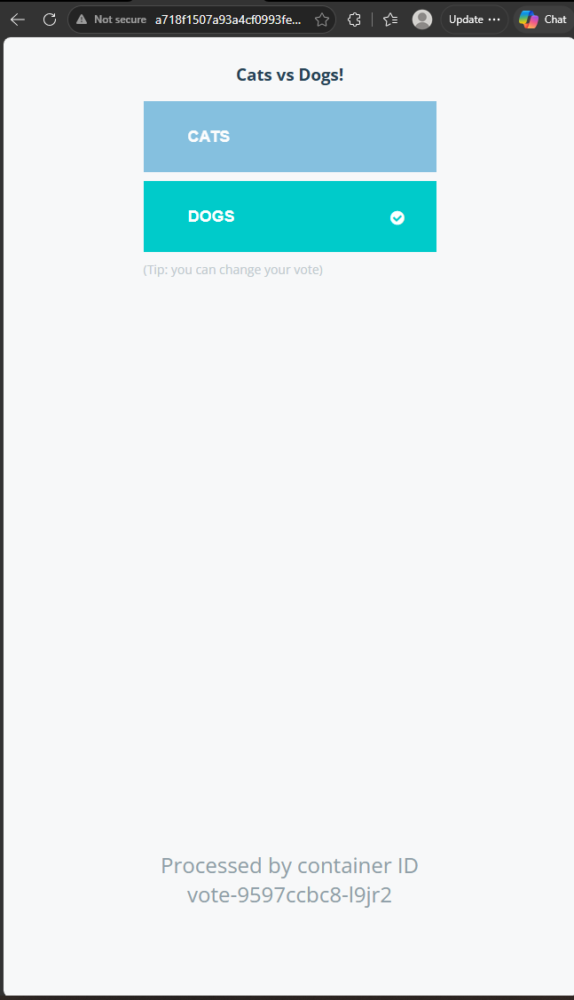
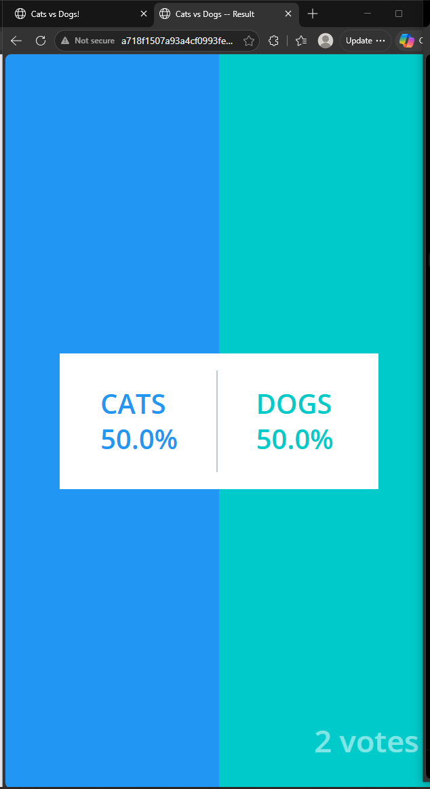
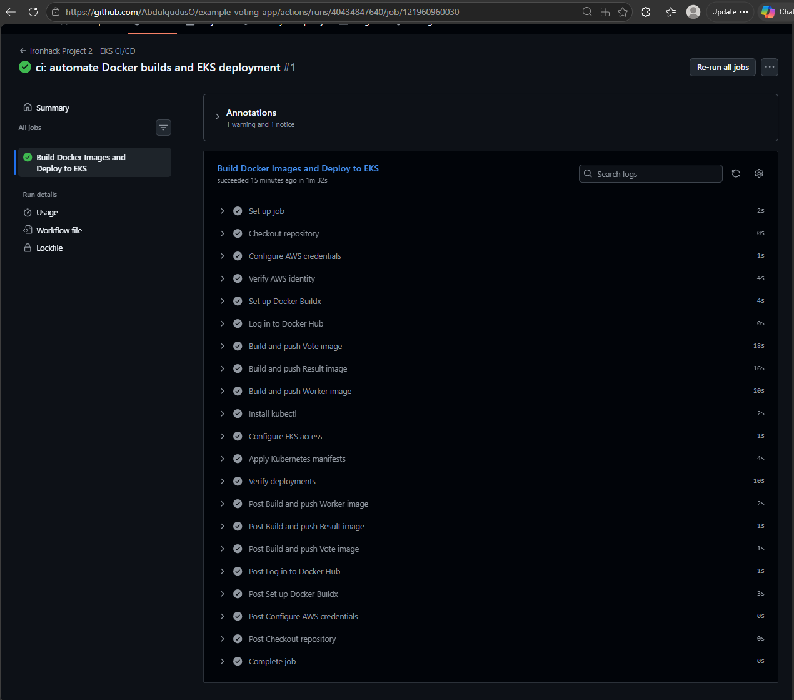
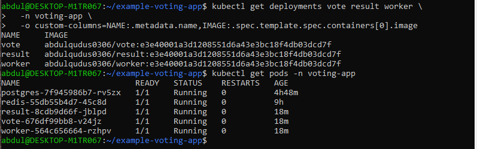
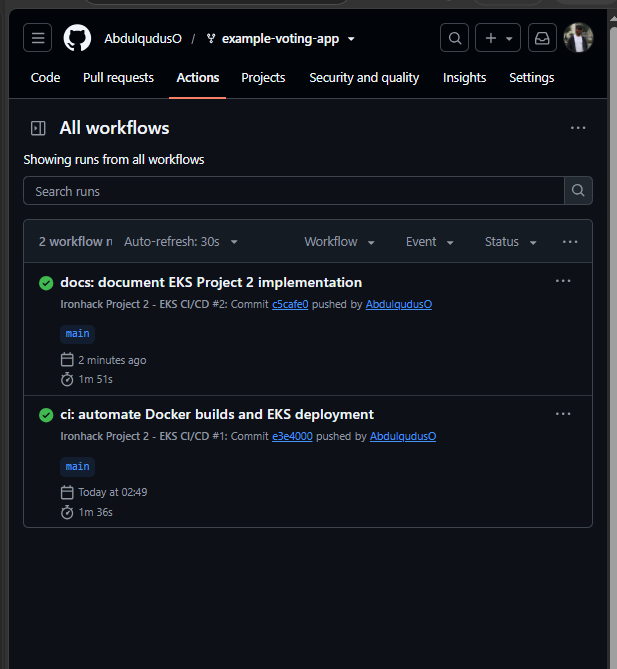

# Ironhack Project 2 — Submission Evidence

**Project:** Deploy a 3-Tier Voting Application on Amazon EKS

**Repository:** https://github.com/AbdulqudusO/example-voting-app

**Successful CI/CD run:** https://github.com/AbdulqudusO/example-voting-app/actions/runs/40434847640

The screenshots below are original captures from the completed lab (26–27 October 2026).

## Evidence

| # | File | What it demonstrates |
|---|---|---|
| 1 | [01-eks-cluster-ready.png](evidence/01-eks-cluster-ready.png) | EKS cluster creation, node Ready, correct cluster context. |
| 2 | [02-five-pods-and-services.png](evidence/02-five-pods-and-services.png) | Five running Pods and ClusterIP Services in voting-app. |
| 3 | [03-public-vote-page.png](evidence/03-public-vote-page.png) | Public Cats vs Dogs Vote page through AWS NGINX Ingress. |
| 4 | [04-public-result-page.png](evidence/04-public-result-page.png) | Public Result page showing Cats 50%, Dogs 50%, two votes. |
| 5 | [05-successful-cicd-run.png](evidence/05-successful-cicd-run.png) | Successful GitHub Actions run; image builds, push and EKS rollout. |
| 6 | [06-sha-tagged-images-and-pods.png](evidence/06-sha-tagged-images-and-pods.png) | Three applications deployed with commit-tagged images, all five Pods running. |
| 7 | [07-two-successful-workflow-runs.png](evidence/07-two-successful-workflow-runs.png) | Both GitHub Actions workflow runs completed successfully. |

## Screenshots

### EKS cluster creation, node Ready, correct cluster context.

### Five running Pods and ClusterIP Services in voting-app.

### Public Cats vs Dogs Vote page through AWS NGINX Ingress.

### Public Result page showing Cats 50%, Dogs 50%, two votes.

### Successful GitHub Actions run; image builds, push and EKS rollout.

### Three applications deployed with commit-tagged images, all five Pods running.

### Both GitHub Actions workflow runs completed successfully.

## Demo verification

- EKS cluster: `eks-abdul-voting-p2` in `eu-central-1`.
- Kubernetes namespace: `voting-app`.
- Five services: Python Vote, Redis, .NET Worker, PostgreSQL, Node.js Result.
- NGINX Ingress: public `/vote` and `/result` endpoints.
- CI/CD: GitHub Actions builds three custom Docker images, pushes to Docker Hub, and updates EKS Deployments.
- Successful pipeline demonstrated by GitHub Actions screenshot and SHA-tagged running images.

## Lab limitations

- One managed EKS worker node: not highly available.
- PostgreSQL used `emptyDir` temporary storage: data could be lost if the Pod is replaced.
- Public browser endpoints used HTTP rather than HTTPS.

## How to add to the repository

Extract the ZIP into the root of `~/example-voting-app` so it contains `PROJECT2_EVIDENCE.md` and the `evidence/` folder. The screenshots are not fabricated or restyled.
